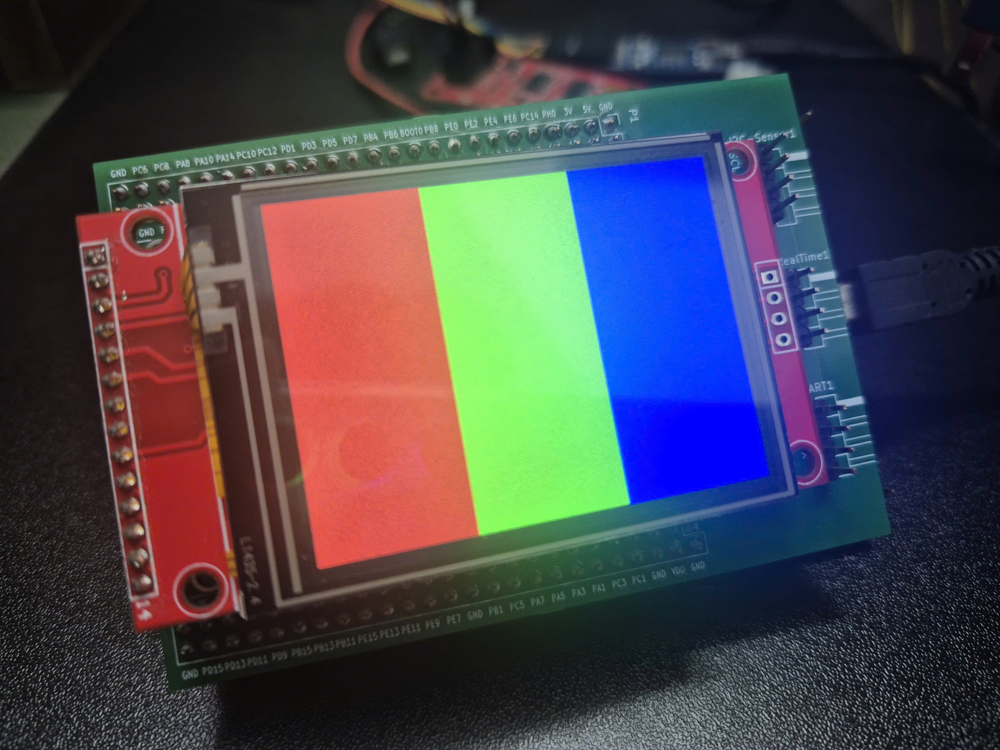
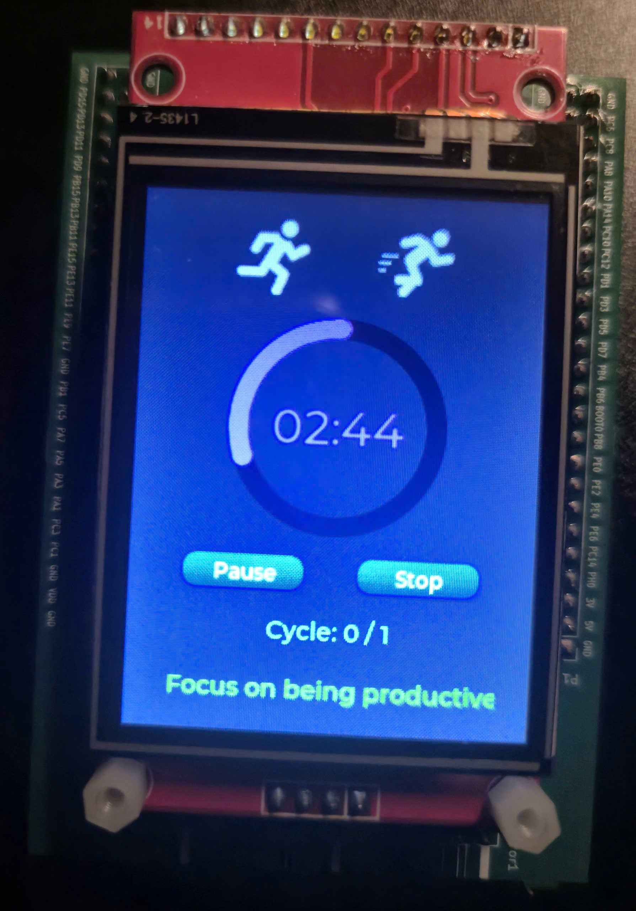

# 🍅 STM32F407 Pomodoro Timer with ILI9341 LCD

A **Pomodoro Timer** application built for the **STM32F407** microcontroller with a **2.4" ILI9341 TFT LCD** display and **LVGL** graphics library. Firmware targets the **[stm32f407_tft_2.4inch_hat](https://github.com/dchithinh/pcb-lab/tree/main/stm32f407_tft_2.4inch_hat)** — a plug-on HAT for the STM32F407 Discovery (2.4" ILI9341 + XPT2046 touch). Schematic, PCB, and pin tables live in the [pcb-lab](https://github.com/dchithinh/pcb-lab) repo.

<div align="center">

**Live UI on the 2.4" ILI9341 (RGB565)**



**STM32F407 Discovery + [stm32f407_tft_2.4inch_hat](https://github.com/dchithinh/pcb-lab/tree/main/stm32f407_tft_2.4inch_hat)**



</div>

---

## 📋 Table of Contents

- [🍅 STM32F407 Pomodoro Timer with ILI9341 LCD](#-stm32f407-pomodoro-timer-with-ili9341-lcd)
  - [📋 Table of Contents](#-table-of-contents)
  - [🎯 Project Overview](#-project-overview)
  - [🖥️ Try Before You Build - Windows Simulator](#️-try-before-you-build---windows-simulator)
  - [🛠️ Hardware Requirements](#️-hardware-requirements)
  - [🔌 Hardware Connections](#-hardware-connections)
    - [HAT board (hardware reference)](#hat-board-hardware-reference)
    - [LCD Display Connections (SPI2)](#lcd-display-connections-spi2)
    - [Touch controller (XPT2046, SPI3, HAT)](#touch-controller-xpt2046-spi3-hat)
    - [Debug UART (USART2)](#debug-uart-usart2)
  - [⚙️ Software Requirements](#️-software-requirements)
  - [🚀 Getting Started](#-getting-started)
    - [Prerequisites](#prerequisites)
    - [Installation](#installation)
    - [Building \& Flashing the Project](#building--flashing-the-project)
  - [🏗️ Project Structure](#️-project-structure)
  - [🔧 Developing Configuration](#-developing-configuration)
    - [Clock Configuration](#clock-configuration)
    - [Display Configuration](#display-configuration)
    - [Debug Configuration](#debug-configuration)
  - [📚 Technical Notes](#-technical-notes)
    - [SPI Communication](#spi-communication)
    - [LVGL Integration](#lvgl-integration)
    - [Known Issues](#known-issues)
  - [🤝 Contributing](#-contributing)
    - [Contribution Guidelines](#contribution-guidelines)
  - [🙏 Acknowledgments](#-acknowledgments)
  - [📬 Contact](#-contact)

---

## 🎯 Project Overview

This project was built for **learning purposes**, focusing on:
- **Embedded GUI development** with LVGL
- **SPI communication** with LCD displays
- **Real-time timer applications**
- **STM32 HAL library** usage and best practices
- **Modular embedded software architecture**

The Pomodoro Technique is a time management method that uses 25-minute work intervals followed by short breaks, helping improve focus and productivity.

---

## 🖥️ Try Before You Build - Windows Simulator

**Want to experience the Pomodoro app before building the hardware?**

Check out **[MicroPomo](https://github.com/dchithinh/MicroPomo)** - a Windows simulator that runs the exact same Pomodoro application with identical UI and functionality. This allows you to:

- 🎮 **Test the complete user interface** and timer functionality
- 🔍 **Explore all features** without any hardware setup
- 📱 **Experience the touch interactions** using mouse input
- ⚡ **Quick evaluation** before investing in STM32 hardware
- 🎯 **Perfect for demonstrations** and proof-of-concept

The simulator uses the same LVGL code base, providing an authentic preview of what you'll get on the actual STM32 hardware.

**[👉 Try MicroPomo Simulator Now](https://github.com/dchithinh/MicroPomo)**

---

## 🛠️ Hardware Requirements

| Component | Specification | Notes |
|-----------|--------------|--------|
| **Microcontroller** | STM32F407VGT6 | ARM Cortex-M4, 168MHz |
| **Display** | 2.4" ILI9341 LCD | 240x320, SPI interface |
| **Touch Controller** | XPT2046 | On-module, SPI3 via HAT |
| **Display HAT** | [stm32f407_tft_2.4inch_hat](https://github.com/dchithinh/pcb-lab/tree/main/stm32f407_tft_2.4inch_hat) | KiCad HAT: ILI9341 2.4", touch, optional microSD / I2C headers |
| **MCU board** | STM32F407 Discovery | Stack the HAT on Discovery **P1 / P2** |
| **Power Supply** | 5V | For LCD backlight |
| **Debugger** | ST-Link/V2 | For programming and debugging |

---

## 🔌 Hardware Connections

Pin assignments below match the HAT README in **[pcb-lab → stm32f407_tft_2.4inch_hat](https://github.com/dchithinh/pcb-lab/tree/main/stm32f407_tft_2.4inch_hat)**. Use that repo for schematic, connector pads, and future PCB revisions.

### HAT board (hardware reference)

| Resource | Link |
|----------|------|
| **HAT project (KiCad, pin map, photos)** | [github.com/dchithinh/pcb-lab/tree/main/stm32f407_tft_2.4inch_hat](https://github.com/dchithinh/pcb-lab/tree/main/stm32f407_tft_2.4inch_hat) |
| **Assembled setup (this repo)** | `Doc/stm32f47_LCD_HAT.jpg` |
| **LCD UI demo (this repo)** | `Doc/RGB.jpg` |

### LCD Display Connections (SPI2)
| LCD Pin | STM32F407 Pin | Function | Notes |
|---------|---------------|----------|-------|
| **VCC** | 5V | Power Supply | External 5V required |
| **GND** | GND | Ground | Common ground |
| **CS** | PB9 | Chip Select | Active low |
| **RESX** | PD10 | Reset | Active low |
| **DCX** | PD9 | Data/Command | Data=1, Command=0 |
| **SDI/MOSI** | PB15 | SPI MOSI | SPI2 data out |
| **SDO/MISO** | PC2 | SPI MISO | Optional for reading |
| **SCK** | PB13 | SPI Clock | SPI2 clock |
| **LED** | 5V | Backlight | Always on |

See the [HAT signal table](https://github.com/dchithinh/pcb-lab/tree/main/stm32f407_tft_2.4inch_hat) for the full map.

### Touch controller (XPT2046, SPI3, HAT)

| Touch signal | Module pin | STM32F407 | SPI / GPIO | HAT net | Discovery (P1) pad |
|--------------|------------|-----------|------------|---------|---------------------|
| **T_CLK** | T_CLK | **PC10** | SPI3_SCK | `LCD_SD_CLK` | 38 |
| **T_DO** | T_MISO | **PC11** | SPI3_MISO | `LCD_SD_MISO` | 37 |
| **T_DIN** | T_MOSI | **PC12** | SPI3_MOSI | `LCD_SD_MOSI` | 36 |
| **T_CS** | T_CS | **PE3** | GPIO (CS, active low) | `LCD_T_CS` | 15 |
| **T_IRQ** | T_IRQ | **PE5** | GPIO input (active low, pull-up) | `LCD_T_IRQ` | 12 |

**Not used for touch on this HAT:** Discovery SPI1 (PA5 / PA6 / PA7), PA8, or PA15 as in older wiring notes.

Touch calibration (min/max, invert) is in `bsp/lvgl/lv_drv_conf.h` (`XPT2046_*`).

### Debug UART (USART2)
| UART Pin | STM32F407 Pin | Function | Notes |
|----------|---------------|----------|-------|
| **TX** | PA2 | Debug output | USART2_TX (AF7) |
| **RX** | PA3 | Debug input | USART2_RX (AF7) |

---

## ⚙️ Software Requirements

- **STM32CubeIDE** Version: 1.17.0
- **STM32CubeMX** (for configuration)
- **STM32 HAL Library** (included)
- **LVGL v9.4.0** (included as submodule)
- **Git** 

---

## 🚀 Getting Started

### Prerequisites

1. Install **STM32CubeIDE**
2. Install **Git** for version control
3. Have your **STM32F407** board and **ILI9341 LCD** ready

### Installation

1. **Clone the repository:**
   ```bash
   git clone https://github.com/dchithinh/stm32f407xx_pomodoro.git
   cd stm32f407xx_pomodoro
   ```

2. **Initialize LVGL submodule:**
   ```bash
   git submodule update --init --recursive
   ```

### Building & Flashing the Project
   Enjoy !!!!

---

## 🏗️ Project Structure

```
stm32f407xx_pomodoro/
├── 📁 Core/
│   ├── 📁 Inc/           # Header files
│   │   ├── main.h
│   │   ├── clock_config.h
│   │   └── debug_utils.h
│   └── 📁 Src/           # Source files
│       ├── main.c
│       ├── clock_config.c
│       └── debug_utils.c
├── 📁 bsp/              # Board Support Package
│   ├── 📁 lcd/          # LCD driver
│   └── 📁 lvgl/         # LVGL port
├── 📁 lvgl/             # LVGL library (submodule)
├── 📁 Drivers/          # STM32 HAL drivers
├── 📁 Doc/              # Datasheets, reference manuals, photos
│   ├── RGB.jpg          # Pomodoro UI on LCD (demo screenshot)
│   └── stm32f47_LCD_HAT.jpg  # Discovery + 2.4" HAT (assembled hardware)
└── 📄 README.md         # This file
```

---

## 🔧 Developing Configuration

### Clock Configuration

The project supports multiple clock configurations in `clock_config.h`:

### Display Configuration

Display settings are configured in `bsp/lcd/config.h`:
- **Resolution:** 240x320
- **Color depth:** 16-bit RGB565
- **Orientation:** Portrait/Landscape

### Debug Configuration

Connect a **USB-to-TTL adapter** to UART2 pins (PA2/PA3) to see debug output:
- **Baud rate:** 115200
- **Data bits:** 8
- **Stop bits:** 1
- **Parity:** None

Debug features can be enabled/disabled in `debug_utils.h`:
- **UART logging:** Enable/disable debug output
- **Touch cursor:** Visual touch point indicator

---

## 📚 Technical Notes

### SPI Communication

**LCD (SPI2)** — settings in `bsp/lcd/lcd.c`:

- **Mode:** Full-duplex master
- **Clock polarity:** Low (CPOL=0)
- **Clock phase:** 1st edge (CPHA=0)
- **Data size:** 8-bit
- **MSB first**

**Touch (SPI3, XPT2046)** — settings in `bsp/lcd/tsc/XPT2046.c`:

- **Pins:** PC10 / PC11 / PC12 (AF6), CS **PE3**, IRQ **PE5** (see `bsp/lcd/hw_def.h`)
- **Mode:** Master, CPOL=0, CPHA=0, 8-bit, software CS on PE3
- **Shared bus:** Same SPI3 lines as the HAT microSD socket; only touch CS (`LCD_T_CS`) is driven for the Pomodoro UI

### LVGL Integration

- **Version:** LVGL v9.4.0
- **Color depth:** 16-bit (RGB565)
- **Memory:** Static allocation
- **Input:** Touch controller integration

### Known Issues

1. **SPI Read Operations:** Unable to read LCD ID/status registers reliably
2. **16-bit HAL SPI:** Issues with 16-bit transfers using HAL API

---

## 🤝 Contributing

---

Contributions are welcome! Please follow these steps:

1. **Fork** the repository
2. **Create** a feature branch (`git checkout -b feature/amazing-feature`)
3. **Commit** your changes (`git commit -m 'Add amazing feature'`)
4. **Push** to the branch (`git push origin feature/amazing-feature`)
5. **Open** a Pull Request

### Contribution Guidelines

- Follow the existing code style
- Add comments for complex functions
- Test your changes thoroughly
- Update documentation as needed

---

## 🙏 Acknowledgments

- **[niekiran/EmbeddedGraphicsLVGL-MCU3](https://github.com/niekiran/EmbeddedGraphicsLVGL-MCU3)** - Original inspiration
- **[LVGL Team](https://lvgl.io/)** - Amazing graphics library
- **[STMicroelectronics](https://www.st.com/)** - STM32 ecosystem and HAL library
- **[stm32f407_tft_2.4inch_hat](https://github.com/dchithinh/pcb-lab/tree/main/stm32f407_tft_2.4inch_hat)** ([pcb-lab](https://github.com/dchithinh/pcb-lab)) — Discovery TFT HAT hardware this firmware is built for
- **[MicroPomo](https://github.com/dchithinh/MicroPomo)** - Windows simulator for testing the Pomodoro app
- **Embedded systems community** - For knowledge sharing and support

---

## 📬 Contact

- **GitHub:** [@dchithinh](https://github.com/dchithinh)
- **Project Link:** [https://github.com/dchithinh/stm32f407xx_pomodoro](https://github.com/dchithinh/stm32f407xx_pomodoro)

---

⭐ **Star this repository** if you found it helpful!

